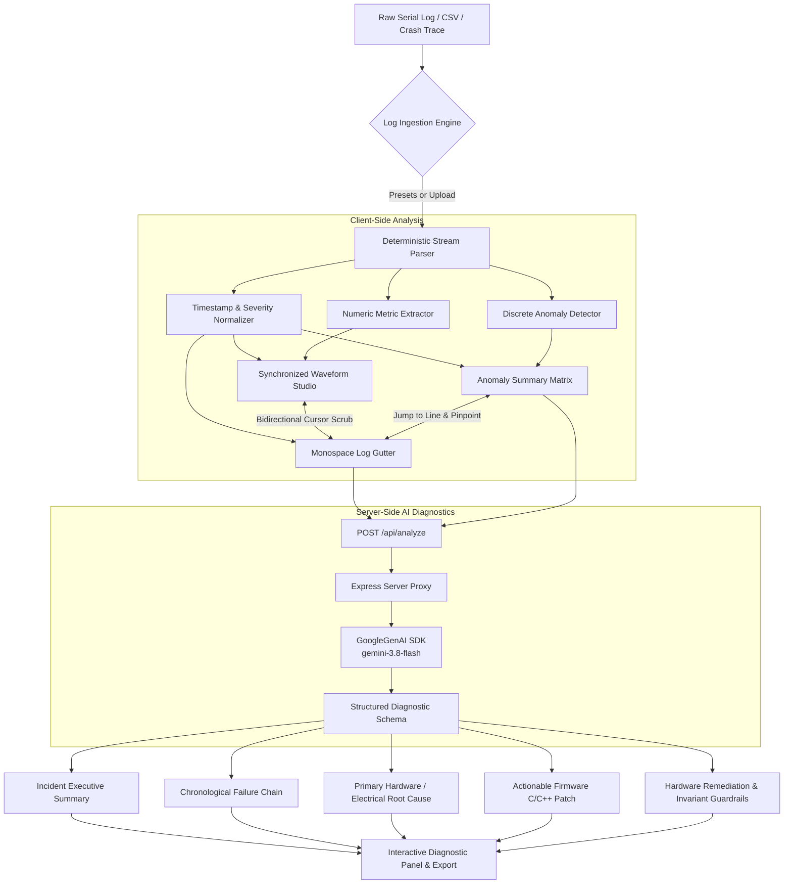

# UART Log RootCause (Serial & Telemetry Log Anomaly Analyzer)

> **Sleek, cyberpunk CRT terminal-inspired web application for embedded systems engineers and firmware developers to ingest raw serial logs, sensor CSV dumps, or crash stack traces, visualize synchronized telemetry waveforms, and generate structured AI-powered root-cause diagnoses with copyable firmware fixes.**

---

## 1. Problem Statement

Microcontroller and IoT bring-up engineers frequently spend hours combing through tens of thousands of lines of raw UART serial logs, telemetry CSV dumps, and register stack traces. Field issues—such as intermittent power brownouts under RF transmit surges, SPI peripheral timeouts, motor harmonic sensor saturation, and ARM Cortex-M HardFault exceptions—often present as cryptic cascades of secondary errors.

Traditional text editors lack:
1. **Physical Metric & Electrical Correlation**: Inability to visually correlate analog voltage droop (`vdd=2.45V`) or sensor clipping (`accel=32.0m/s²`) directly with kernel crashes or frame loss.
2. **Synchronized Timeline Scrubbing**: No bidirectional linkage between time-series waveforms and raw console log gutters.
3. **Automated Root-Cause Intelligence**: Engineers must manually cross-reference silicon reference manuals, errata sheets, and NVIC fault registers (CFSR, HFSR) to deduce why an execution state was invalid or why an SPI bus locked up.

**UART Log RootCause** solves this by unifying instant regex/heuristic telemetry extraction with Google Gemini 3.8 Flash server-side intelligence, isolating the primary electrical or register failure and providing copyable C/C++ firmware remediation patches in seconds.

---

## 2. Mermaid Processing Flow



---

## 3. Key Capabilities & Features

- **Cyberpunk CRT Terminal Aesthetic**: Dark obsidian slate theme with amber phosphor and emerald telemetry accents, toggleable subtle scanline curvature, and tactile Web Audio click feedback.
- **Synchronized Telemetry Waveform Studio**: High-precision SVG dual-channel scope that plots fluctuating voltages, acceleration, yaw rate, and packet losses. Hovering or scrubbing the timeline immediately pins and highlights the corresponding line in the log gutter.
- **Anomaly Summary Matrix**: High-density tabular overview classifying discrete events:
  - **Brownout Resets (BOD)** & RTCWDT resets
  - **SPI / I2C Bus Lockups** & timeout thresholds
  - **Packet Loss & CRC Mismatches**
  - **Sensor Dynamic Range Saturation & Clipping**
  - **ARM Cortex-M HardFault Exceptions (INVSTATE, BusFault, Imprecise Violations)**
  - **FreeRTOS Stack Overflow & Proximity Collisions**
- **Structured Root-Cause Diagnosis (Powered by Gemini 3.8 Flash)**:
  - Exact failure sequence timeline
  - Affected hardware and silicon subsystems
  - Copyable C/C++ or FreeRTOS driver patch
  - PCB & schematic fix recommendations (decoupling capacitors, pull-up sizing, star grounding)
- **One-Click Pre-Loaded Simulation Presets**:
  1. **ESP32 + SX1262 LoRa Node**: High PA boost (+22dBm) triggers 3.3V rail droop to 2.38V, locking the SPI bus and causing a hardware brownout restart.
  2. **STM32F407 HardFault Dump**: UsageFault `INVSTATE` caused by corrupted function pointer LSB (Thumb bit cleared to 0) in FreeRTOS CAN interrupt context.
  3. **PX4 Drone IMU Saturation CSV**: Propeller vibration resonance at 180Hz saturating ICM-42688-P accelerometer dynamic ceiling (±32 m/s²), triggering EKF2 divergence and telemetry packet loss.

---

## 4. Usage Guide

### Step 1: Ingest Log Stream
- Select one of the three simulation presets at the top (`ESP32 / LoRa Brownout`, `STM32 HardFault`, `PX4 Drone CSV`).
- Or click **"Paste Custom Raw Log"** to paste your own serial stream, gdb crash log, or CSV telemetry dump, or drag-and-drop a `.log` / `.csv` file.

### Step 2: Inspect Telemetry & Anomaly Matrix
- Hover over the **Synchronized Telemetry Waveform Studio** to inspect metrics. Clicking any point jumps the log gutter directly to that exact line.
- Review the **Hardware & Firmware Anomaly Matrix** for classified faults. Click **"Jump"** on any row to focus the raw console on that event.

### Step 3: Run AI Root Cause Diagnosis
- Click **"Run AI Root Cause"** in the top bar.
- The server will query `gemini-3.8-flash` with the raw log and pre-extracted anomalies.
- Review the executive summary, register breakdown, schematic recommendations, and copy the proposed C/C++ firmware fix.
- Click **"Export Report (MD)"** to copy a complete Markdown post-mortem incident report.

---

## 5. Local Setup & Environment Variables

### Prerequisites
- Node.js >= 18
- npm

### Installation
```bash
# Clone the repository
git clone <repo-url>
cd uart-log-rootcause

# Install dependencies
npm install

# Start the full-stack dev server (Express + Vite on port 3000)
npm run dev
```

### Environment Configuration (`.env`)
Create a `.env` file in the root directory (based on `.env.example`):

```bash
# GEMINI_API_KEY: Required for Gemini AI API calls.
# Obtain your API key from Google AI Studio (https://aistudio.google.com).
GEMINI_API_KEY="your-gemini-api-key-here"

# Server Port (defaults to 3000)
PORT=3000
```

> **Note**: Even if no API key is configured, UART Log RootCause includes an offline embedded heuristic rules engine that reliably analyzes known microcontroller failure modes (brownout drops, HardFault INVSTATE register decodes, and sensor saturation) with zero setup required.

---

## 6. Architecture & Tech Stack

| Component | Technology | Rationale |
| :--- | :--- | :--- |
| **Frontend Framework** | React 19 + TypeScript | High performance, strict type safety for register structures |
| **Styling & Theme** | Tailwind CSS v4 | Obsidian & phosphor CRT terminal aesthetic, zero pill clutter |
| **Icons & Typography** | Lucide React, JetBrains Mono | Monospace tabular figures and telemetry visualization |
| **Backend Server** | Express 4 + Node.js | Strict API key isolation on server side, port 3000 |
| **AI Reasoning Engine** | `@google/genai` (gemini-3.8-flash) | State-of-the-art fast multimodal & structured JSON diagnostic synthesis |
| **Audio Micro-Interactions** | Web Audio API | Zero external dependencies; tactile retro terminal audio feedback |

---

## 7. License
Apache-2.0
